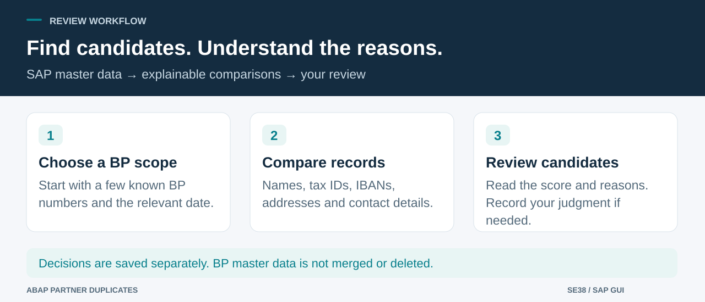

# Find likely duplicate business partners in SAP

> **English** | [Türkçe](README.tr.md)

**Install one ABAP report. Scan selected business partners. Review the reasons.**

`ZCHE_DUPL_FIND` helps you find SAP Business Partner (BP) records that may refer to the same person or company. It compares names, tax numbers, IBANs, addresses, phone numbers and email addresses, then shows candidate pairs with a score and an explanation.

You can record **Duplicate** or **Not a duplicate**. Decisions are saved separately; the report does not merge, block or delete BP master data. A score helps prioritize review; it is not a probability or a final identity decision.

## Start with these three parts

| Part | What you prepare |
|---|---|
| **1. SAP report** | Upload one source file in SE38, set program attributes and activate it. abapGit is an alternative. |
| **2. Permissions** | Create the required authorization object and assign approved BP groups. Work with your authorization administrator if needed. |
| **3. First scan** | Select a few known BP numbers, keep identifiers masked and inspect the result before expanding the scope. |

Everything runs in SAP. No external service or application-host software is required. Installation assumes you can create and activate a report in SE38.

## Choose your next step

| Your goal | Guide |
|---|---|
| Install and run the first scan | [Step-by-step walkthrough](docs/WALKTHROUGH.md#install) |
| Understand every selection field | [Selection screen explained](docs/WALKTHROUGH.md#fields) |
| Record or reverse a decision | [Review candidates](docs/WALKTHROUGH.md#decisions) |
| Run regular background scans | [Variant and job setup](docs/WALKTHROUGH.md#jobs) |
| Understand matching or extend the code | [Technical reference](docs/TECHNICAL.md) |

## Before you start

- Use a Unicode SAP DEV/test system with **Business Partner** data and the standard tables/APIs used by the report. Customer/vendor-only ECC systems need a different source implementation.
- An authorized developer installs the report; **SU21/PFCG** administration is required for `ZCHE_DUPL` and the allowed BP authorization groups.
- Use SAP GUI for interactive decisions. Screen labels follow your logon language: Turkish for Turkish logons, English otherwise. Finding codes and some diagnostic reasons remain English.
- Confirm the tax category in your system. **`TR2` is an example default**, not a universal setting. Turkish checksum checks are optional and off by default.

The scan reads identifying, contact and bank data within the granted BP group scope. Review that access before assigning it; see [permissions and data handling](SECURITY.md). Masking tax numbers and IBANs does not make the remaining output anonymous.

## First useful result

1. [Open the source](src/zche_dupl_find.prog.abap), choose **Raw / Download raw file**, and upload it into executable report `ZCHE_DUPL_FIND` in SE38. Follow the [program-attribute and permission steps](docs/WALKTHROUGH.md#install).
2. Enter **two or more BP numbers from your own test system** in **Business partners**. Empty filters broaden the scan; start with an explicit small selection.
3. Keep **Full tax numbers and IBANs** unchecked, confirm the tax category, and execute with **F8**.
4. Review both BP records, the score and the reasons. Recording a decision is optional.

A blank result means no candidates met the current rules and limits. Check the partner count and **Not compared** messages before drawing conclusions.

## Status

**v0.4.0 is in development.** The source targets classic **ABAP 7.00 syntax**. Local checks are recorded in [VALIDATION.md](VALIDATION.md). The current revision has not been activated or executed in SAP; API availability, permissions, SQL selection, decisions and GUI/job behavior need target-system acceptance. Historical v0.3 results do not validate this revision. This is classic ABAP, not an ABAP Cloud application.

MIT licensed. [Contributing](CONTRIBUTING.md) · [Changelog](CHANGELOG.md) · [Report a bug](https://github.com/Cheditte/abap-partner-duplicates/issues/new?template=bug_report.yml)
