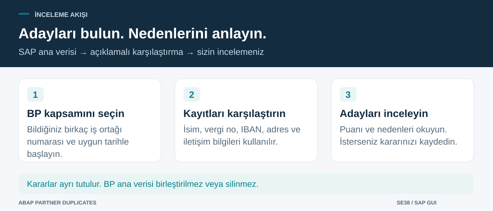

# SAP’de olası mükerrer iş ortaklarını bulun

> [English](README.md) | **Türkçe**

**Tek bir ABAP raporu kurun. Seçtiğiniz iş ortaklarını tarayın. Nedenleri inceleyin.**

`ZCHE_DUPL_FIND`, SAP’de aynı kişi veya şirket için açılmış olabilecek Business Partner (BP / iş ortağı) kayıtlarını bulmanıza yardımcı olur. İsim, vergi numarası, IBAN, adres, telefon ve e-posta bilgilerini karşılaştırır; aday çiftleri bir puan ve gerekçeyle gösterir.

**Mükerrer** veya **Mükerrer değil** kararı kaydedebilirsiniz. Kararlar ayrı tutulur; rapor BP ana verisini birleştirmez, bloke etmez veya silmez. Puan, inceleme sırasını belirlemeye yardımcı olur; olasılık veya kesin kimlik kararı değildir.

## Başlamak için üç bölüm var

| Bölüm | Ne hazırlayacaksınız? |
|---|---|
| **1. SAP raporu** | Tek kaynak dosyasını SE38’e yükleyin, program özelliklerini ayarlayıp aktifleştirin. abapGit alternatif bir yoldur. |
| **2. Yetkiler** | Gerekli yetki nesnesini oluşturun ve izin verilen BP gruplarını atayın. Gerekiyorsa yetki yöneticisiyle ilerleyin. |
| **3. İlk tarama** | Bildiğiniz birkaç BP numarasını seçin, numaraları maskeli tutun ve kapsamı büyütmeden sonucu inceleyin. |

Bütün işlemler SAP içinde yapılır. Dış servis veya SAP sunucusuna ek yazılım kurulumu gerekmez. Kurulumu yapacak kişinin SE38’de program oluşturup aktifleştirebildiği varsayılır.

## Hedefinize göre ilerleyin

| Yapmak istediğiniz | Rehber |
|---|---|
| Kurmak ve ilk taramayı çalıştırmak | [Adım adım kurulum](docs/tr/WALKTHROUGH.md#install) |
| Seçim ekranındaki alanları anlamak | [Alanlar ne işe yarar?](docs/tr/WALKTHROUGH.md#fields) |
| Karar kaydetmek veya değiştirmek | [Adayları inceleme](docs/tr/WALKTHROUGH.md#decisions) |
| Düzenli arka plan taraması yapmak | [Varyant ve job kurulumu](docs/tr/WALKTHROUGH.md#jobs) |
| Eşleştirme mantığını anlamak veya kodu geliştirmek | [Teknik başvuru](docs/tr/TECHNICAL.md) |

## Başlamadan önce

- **Business Partner** verisi ve raporun kullandığı standart tablo/API’ler bulunan Unicode bir SAP DEV/test sistemi gerekir. Yalnız müşteri/tedarikçi tabloları kullanan eski ECC sistemleri için veri kaynağı uyarlanmalıdır.
- Raporu yetkili geliştirici kurar. `ZCHE_DUPL` ve izin verilen BP yetki grupları için **SU21/PFCG** yönetim yetkisi gerekir.
- Etkileşimli kararlar için SAP GUI kullanılır. Ekran etiketleri Türkçe oturumda Türkçe, diğer dillerde İngilizcedir. Bulgu kodları ve bazı teknik açıklamalar İngilizce kalır.
- Vergi kategorisini kendi sisteminizde doğrulayın. **`TR2` örnek varsayılandır**; her sisteme aynen yazılacak bir değer değildir. Türk numaralarının kontrol hanesi denetimi isteğe bağlıdır ve başlangıçta kapalıdır.

Tarama, izin verilen BP grupları içindeki kimlik, iletişim ve banka detaylarını okuyabilir. Rol atamadan önce bu kapsamı değerlendirin: [yetkiler ve veri kullanımı](SECURITY.md#turkce). Vergi no ve IBAN maskeli olsa da diğer sonuçlar anonim değildir.

## İlk anlamlı sonuca ulaşın

1. [Kaynağı açın](src/zche_dupl_find.prog.abap), **Raw / Download raw file** ile indirin ve SE38’de `ZCHE_DUPL_FIND` yürütülebilir raporuna yükleyin. [Program özellikleri ve yetki adımlarını](docs/tr/WALKTHROUGH.md#install) izleyin.
2. **İş ortakları** alanına **kendi test sisteminizden en az iki BP numarası** girin. Boş filtreler kapsamı genişletir; önce küçük ve açık bir seçim yapın.
3. **Vergi no ve IBAN tam görünsün** kapalı kalsın. Vergi kategorisini doğrulayın ve **F8** ile çalıştırın.
4. İki BP kaydını, puanı ve nedenleri inceleyin. Karar kaydetmek isteğe bağlıdır.

Boş liste, mevcut kurallara ve sınırlara göre aday bulunmadığını gösterir. Yorum yapmadan önce okunan iş ortağı sayısını ve **Karşılaştırılmadı** mesajlarını kontrol edin.

## Durum

**v0.4.0 geliştirme aşamasında.** Kaynak klasik **ABAP 7.00 sözdizimini** hedefler. Yerel kontroller [VALIDATION.md](VALIDATION.md) dosyasında kayıtlıdır. Güncel revizyon SAP’de aktifleştirilip çalıştırılmadı; API, yetki, SQL seçimi, karar kaydı ve GUI/job davranışı hedef sistemde doğrulanmalıdır. Eski v0.3 sonuçları bu revizyonun doğrulaması değildir. Uygulama klasik ABAP içindir.

MIT lisansı. [Katkı rehberi](CONTRIBUTING.md) · [Değişiklikler](CHANGELOG.md) · [Hata bildirimi](https://github.com/Cheditte/abap-partner-duplicates/issues/new?template=bug_report.yml)
