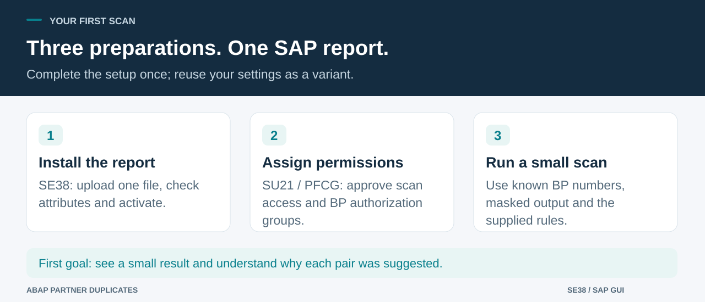

# Install, scan and review

> **English** | [Türkçe](tr/WALKTHROUGH.md) · [Project overview](../README.md)

The first goal is a small, explainable result: choose known test BPs, run a scan and understand why each pair was suggested. Recording decisions and regular background scans come afterwards.

## 1. Install the report

### 1.1 Prepare the source and program

1. Use an authorized **DEV/test** system. Open [the complete source](../src/zche_dupl_find.prog.abap) on GitHub and choose **Raw / Download raw file**. Save a plain `.abap` file, not the GitHub HTML webpage. Keep UTF-8 encoding so Turkish characters survive.
2. In **SE38**, enter **`ZCHE_DUPL_FIND`** and choose **Create**.
3. Set **Type: Executable program**. **Enable Fixed point arithmetic**: scoring uses decimal arithmetic. Use the standard/classic ABAP language version where that setting exists. Give the report a descriptive title.
4. Use a transportable customer package for shared use. **Local Object / `$TMP`** is suitable for an isolated trial; it is not a transport strategy.
5. In the editor, choose **Utilities → More Utilities → Upload/Download → Upload** (menu wording varies), or paste the complete source. Local classes, screen labels and unit tests are included. No separate includes or custom DDIC tables are required. All source lines fit 72 columns.
6. Complete the authorization setup below, then **check syntax and activate**. If a standard API/table is missing, review the target-system requirements. Keep the authorization checks.

Alternatively, import the repository into a customer package using abapGit. Only `src/` is installable; `.abaplint-deps/` and `tests/logic/` contain local development fixtures.

### 1.2 Prepare permissions

Do this yourself if you have the required administrative access; otherwise give this section to your authorization administrator.

1. In **SU21**, choose a suitable customer authorization class and create **`ZCHE_DUPL`**. Add standard field **`ACTVT`** with permitted activities **`02`, `03`, `16`**. Save it to the appropriate transport.
2. In **PFCG**, maintain reviewed roles for the test user. Activity **03** runs scans; **16** additionally allows full tax number/IBAN display; **02** additionally allows decisions to be saved. A first review-only user needs **03**.
3. Add **`B_BUPA_GRP`**, activity **03**, and the approved **`BEGRU`** values. These are BP **authorization groups** in `BUT000-AUGRP`, including the blank group where appropriate. They differ from the BP **grouping** filter on the report.
4. Save/generate the role and perform the usual user comparison/logon refresh. Use **SU53** immediately after an authorization failure to investigate it with the administrator.

Activity 03 grants aggregate access to identifying, bank and contact data within these groups. It does not reproduce every field-level restriction of the standard BP dialog. Review this scope before assigning access; see [SECURITY.md](../SECURITY.md).

## 2. Run a limited first scan

1. Open **SE38 → `ZCHE_DUPL_FIND` → Execute (F8)**.
2. In **Business partners**, enter two or more known BPs from your test client. Use multiple selection for separate values. **Both members of a pair must be in scope.** This is not a selected-BP-versus-everyone search.
3. Confirm the **tax category** with the BP data owner. `TR2` is only the supplied example. Leave the **reference date** at today unless reviewing another date.
4. Keep **Full tax numbers and IBANs** unchecked. Leave **Check Turkish VKN/TCKN** off unless you deliberately want Turkish checksum diagnostics.
5. Start with the supplied weights and **lowest score 60**, then execute **F8**.
6. Check the partner count, finding type, score, reasons and skipped-key messages. Compare the actual BP records before deciding.

For a controlled example, the *invented* names “Derya Tekstil Ltd. Şti.” and “DERYA TEKSTİL SANAYİ TİCARET A.Ş.” normalize to the same name. With only the default name contribution, the expected score is **70**. The report does not create test master data; use your approved process if you need a planted pair.

## 3. What each selection field does

Labels are Turkish for a Turkish SAP logon and English otherwise. There is no separate language parameter. Some result reasons and codes remain English.

| Field | How to fill it |
|---|---|
| **Business partners** (`S_PART`) | Actual BP numbers/ranges. Use a few explicit values first. Blank means all otherwise eligible BPs. All filters are combined. |
| **BP role** (`P_ROLE`) | Optional role code; only roles valid at the reference date qualify. Blank means no role restriction. |
| **BP grouping** (`P_GROUP`) | Optional grouping code, not an authorization group. Blank means no grouping restriction. |
| **Country** (`P_CNTRY`) | Optional country key, e.g. `TR` for a Turkish-only selection. A BP qualifies if it has a valid address in that country. |
| **Tax number category** (`P_TAXTY`) | Category containing the intended identifiers. Confirm its meaning; do not assume `TR2` is correct. To leave it blank, set tax weight to 0 and disable Turkish checks. |
| **Reference date** (`P_KEYDT`) | Required date for valid roles, addresses, contacts and bank records; defaults to today. Timestamp validity is evaluated at **00:00 UTC**. |
| **Check Turkish VKN/TCKN** (`P_TAXCHK`) | Checks format/control digits of loaded identifiers. It does not verify registration or ownership. Use only an appropriate Turkish data set/category. |
| **Rule weights** | Tax 95, IBAN 90, name 70, address 50, phone 40, email 40 by default. **0 disables a rule**; 1–100 sets its contribution. |
| **Name similar at least (%)** (`P_MINSIM`) | Minimum similarity for name evidence, default **85**. Separate from the total-score threshold. |
| **Show pairs from score** (`P_THRESH`) | Combined score required to show a pair, default **60**. Raising it shows fewer candidates. |
| **Max. partners per key** (`P_MAXBLK`) | Default **200**. A shared key with more members is skipped and reported. This is not a limit on total BPs read. |
| **Extra words to ignore** (`S_STOP`) | Optional words such as “Holding”. Use included single values only. Removing distinctive words can increase false positives. |
| **Full tax numbers and IBANs** (`P_UNMASK`) | Off by default; requires 03 plus **16**. When enabled, output/export/spool may contain raw identifiers. |
| **Include not-duplicate pairs** (`P_DECID`) | Includes previously rejected pairs for reconsideration. Duplicate-marked pairs remain visible if they still match. Previously labelled “Show decided pairs”. |

At least one matching rule or Turkish checks must remain enabled. A different explicit country with Turkish checks is rejected; a blank country does **not** establish that every selected identifier is Turkish.

## 4. Review and optionally save a decision

1. Read the finding type. `DUPLICATE` is a candidate pair; `INVALID_TAX_ID` is an optional checksum finding about one BP and has no decision action.
2. Read the reasons and inspect both BPs through your usual review process. A high score can reflect a shared group IBAN, address or switchboard.
3. Click **Duplicate** or **Not dup.** on the pair to save your judgment. Activity **02** is required. **The decision is saved immediately**; there is no later Save-all step. Viewing the list writes no decision.
4. The decision changes only this report's client-local record. It does not update/merge either BP. The latest user/time is retained, not a full audit history.
5. To reverse a decision, select **Include not-duplicate pairs**, run again and click the other decision icon. The pair must still match current rules and scope; this is not a list of all historical decisions.

A Not-a-duplicate pair remains on the current display and is hidden in later scans unless included. Reassess exclusions when master data changes. Decisions are not transported.

## 5. Schedule regular scans

1. First validate the scope/settings in the foreground. Use a dedicated authorized job user with reviewed scan/BP-group permissions.
2. Save a **variant** with the scope, rules and masked output. If the reference date should follow the current day, use the variant's dynamic-date selection variable for **`P_KEYDT`**. A literal date stays fixed.
3. In **SM36**, create a clearly named job, e.g. `ZCHE_DUPL_WEEKLY`. Add an **ABAP program** step with **`ZCHE_DUPL_FIND`**, the variant and the approved execution user.
4. Set a start condition. Add a periodic schedule after inspecting the first scheduled run. Save/release according to your normal process. Your administrator assigns the necessary standard background-processing permissions.
5. In **SM37**, inspect status, job log and spool. Read the counts and skipped-key messages. Finished alone does not establish data quality/completeness. Decisions require a foreground ALV session.

Real SAP jobs and restricted-user behavior for this revision still await acceptance; see [validation](../VALIDATION.md).

## 6. If you get stuck

| Situation | Next action |
|---|---|
| Missing permission / no authorized BPs | Check SU53 with the administrator; review `ZCHE_DUPL` and `B_BUPA_GRP`, including blank groups. |
| No partners read | Check BP numbers, client, deletion flags, role/grouping/country and reference date. Customer/vendor records without BP are not this source. |
| Partners read but no pairs | Check threshold, disabled rules, missing shared blocking keys and prior Not-a-duplicate decisions. |
| **Not compared** | A shared key exceeded the member limit. Narrow the scope or investigate it before raising the limit. |
| Foreign identifiers flagged | Disable Turkish checks or choose the correct Turkish scope/category. |
| English labels | They follow the SAP logon language. Some reasons/codes remain English in Turkish sessions. |
| Syntax/API error | Record revision, SAP_BASIS and exact line/message in the [bug form](https://github.com/Cheditte/abap-partner-duplicates/issues/new?template=bug_report.yml), using sanitized details. |

[Technical reference](TECHNICAL.md) · [Security](../SECURITY.md) · [Validation](../VALIDATION.md)
