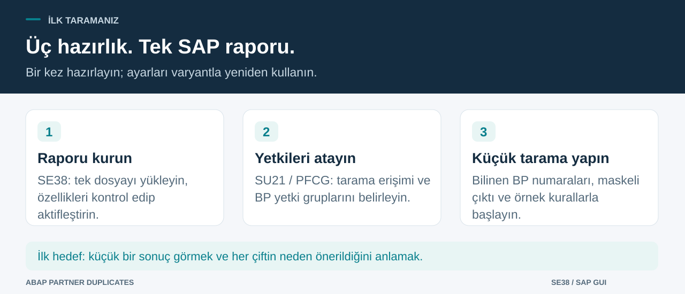

# Kurulumdan ilk taramaya

> [English](../WALKTHROUGH.md) | **Türkçe** · [Proje özeti](../../README.tr.md)

İlk hedef küçük ve anlaşılır bir sonuçtur: bildiğiniz test BP’lerini seçin, tarayın ve adayların neden gösterildiğini anlayın. Karar kaydetme ve düzenli job planlama daha sonra gelir.

## 1. Raporu kurun

### 1.1 Kaynağı ve programı hazırlayın

1. Yetkili olduğunuz **DEV/test** sistemini kullanın. GitHub’da [kaynak dosyasını](../../src/zche_dupl_find.prog.abap) açıp **Raw / Download raw file** ile indirin. GitHub HTML sayfasını değil, düz `.abap` dosyasını kaydedin. Türkçe karakterlerin korunması için UTF-8 kodlamasını değiştirmeyin.
2. **SE38**’de **`ZCHE_DUPL_FIND`** yazıp **Create / Oluştur** seçin.
3. **Type / Tür: Executable program / Yürütülebilir program** seçin. **Fixed point arithmetic / Sabit noktalı aritmetik açık olmalı:** puan hesabı ondalıklı aritmetik kullanır. Dil sürümü seçimi varsa standart/klasik ABAP kullanın. Açıklayıcı bir program başlığı yazın.
4. Ortak kullanım için transport edilebilir müşteri paketi seçin. **Local Object / `$TMP`**, yalnız izole denemeye uygundur.
5. Kaynak editöründe **Utilities → More Utilities → Upload/Download → Upload** yolunu kullanın veya kaynağın tamamını yapıştırın. Menü adı GUI diline göre değişebilir. Yerel sınıflar, ekran metinleri ve testler dosyanın içindedir; ayrı include veya özel DDIC tablosu gerekmez. Bütün kaynak satırları 72 sütuna sığar.
6. Aşağıdaki yetki kurulumunu tamamlayın, ardından **sözdizimini kontrol edip aktifleştirin**. Standart tablo/API eksikse hedef sistem gereksinimlerini inceleyin. Yetki kontrollerini kaldırmayın.

Ekibiniz abapGit kullanıyorsa müşteri paketine içe aktarabilirsiniz. SAP’ye kurulacak kaynak `src/` içindedir; `.abaplint-deps/` ve `tests/logic/` yerel geliştirme dosyalarıdır.

### 1.2 Yetkileri hazırlayın

Yönetim yetkiniz varsa kendiniz yapın; yoksa bu bölümü yetki yöneticinize iletin.

1. **SU21**’de uygun müşteri nesne sınıfını seçip **`ZCHE_DUPL`** oluşturun. Standart **`ACTVT`** alanını ve **`02`, `03`, `16`** aktivitelerini ekleyin. İlgili transport’a kaydedin.
2. **PFCG**’de test kullanıcısının rolünü düzenleyin. **03** tarama; **16** buna ek maskesiz vergi no/IBAN; **02** buna ek karar kaydı içindir. İlk inceleme kullanıcısına **03** yeterlidir.
3. **`B_BUPA_GRP`**, aktivite **03**, onaylı **`BEGRU`** değerlerini tanımlayın. Bunlar `BUT000-AUGRP` içindeki BP **yetki gruplarıdır**; gerekiyorsa boş grup da değerlendirilir. Seçim ekranındaki BP **gruplamasıyla** aynı alan değildir.
4. Rolü kaydedip üretin; sisteminizdeki kullanıcı karşılaştırması/oturum yenileme adımlarını uygulayın. Yetki hatasının hemen ardından **SU53** ile eksik kontrolü yetki yöneticisiyle inceleyin.

03 aktivitesi, izin verilen gruplardaki kimlik, banka ve iletişim verilerine toplu erişim verir. Standart BP ekranının bütün alan kısıtlarını yeniden uygulamaz. Atamadan önce kapsamı inceleyin: [güvenlik ve veri kullanımı](../../SECURITY.md#turkce).

## 2. Sınırlı ilk taramayı yapın

1. **SE38 → `ZCHE_DUPL_FIND` → Çalıştır (F8)** ile seçim ekranını açın.
2. **İş ortakları** alanına kendi test istemcinizden en az iki BP girin. Ayrı numaralar için çoklu seçim düğmesini kullanın. **Çiftin iki tarafı da seçime dahil olmalıdır.** Seçtiğiniz BP’ler bütün veri tabanıyla karşılaştırılmaz.
3. **Vergi kategorisini** ana veri sorumlusuyla doğrulayın. `TR2` yalnız örnek varsayılandır. Başka bir tarihi incelemiyorsanız referans tarihi bugün kalsın.
4. **Vergi no ve IBAN tam görünsün** kapalı kalsın. Özellikle Türk numara kontrolü yapmak istemiyorsanız **Türk VKN/TCKN kontrolü** de kapalı olsun.
5. Örnek ağırlıkları ve **en düşük puan 60** değerini koruyup **F8** ile çalıştırın.
6. Okunan BP sayısını, bulgu türünü, puanı, nedenleri ve atlanan anahtar mesajlarını inceleyin. Karar vermeden önce gerçek BP kayıtlarını karşılaştırın.

Kontrollü örnek olarak *uydurma* “Derya Tekstil Ltd. Şti.” ve “DERYA TEKSTİL SANAYİ TİCARET A.Ş.” adları aynı isme dönüşür. Yalnız varsayılan isim katkısıyla beklenen puan **70**’tir. Program test BP’si oluşturmaz; örnek çift gerekiyorsa kurumun onaylı ana veri oluşturma sürecini kullanın.

## 3. Her alan ne işe yarar?

Etiketler Türkçe SAP oturumunda Türkçe, diğer dillerde İngilizcedir. Ayrı dil parametresi yoktur. Bazı bulgu açıklamaları ve kodları İngilizce kalır.

| Alan | Nasıl doldurulur? |
|---|---|
| **İş ortakları** (`S_PART`) | Gerçek BP numaraları/aralıkları. Önce birkaç açık değer girin. Boşsa diğer koşullara uygun bütün BP’ler seçilir. Filtreler birlikte uygulanır. |
| **İş ortağı rolü** (`P_ROLE`) | İsteğe bağlı rol kodu. Referans tarihinde geçerli roller alınır. Boşsa rol kısıtı yoktur. |
| **Gruplama** (`P_GROUP`) | İsteğe bağlı BP gruplaması; yetki grubu değildir. Boşsa gruplama kısıtı yoktur. |
| **Ülke** (`P_CNTRY`) | İsteğe bağlı ülke anahtarı; örneğin yalnız Türkiye adreslileri seçmek için `TR`. O ülkede geçerli bir adresi olan BP kapsama girer. |
| **Vergi numarası kategorisi** (`P_TAXTY`) | Karşılaştırılacak numaraların kategorisi. `TR2`’yi doğru kabul etmeyin. Boş bırakmak için vergi ağırlığı 0, Türk kontrolü kapalı olmalıdır. |
| **Ana veri referans tarihi** (`P_KEYDT`) | Rol, adres, iletişim ve banka geçerlilik tarihi; zorunlu, varsayılan bugün. Zaman damgaları **00:00 UTC** için değerlendirilir. |
| **Türk VKN/TCKN kontrolü** (`P_TAXCHK`) | Yüklenen numaraların biçim/kontrol hanesini denetler. Vergi kaydı veya sahiplik sorgusu yapmaz. Yalnız uygun Türk veri kümesi/kategoriyle açın. |
| **Kural ağırlıkları** | Varsayılan vergi 95, IBAN 90, isim 70, adres 50, telefon 40, e-posta 40. **0 kuralı kapatır**; 1–100 katkıyı belirler. |
| **İsim en az % kaç benzer** (`P_MINSIM`) | İsim katkısı için benzerlik eşiği, varsayılan **85**. Toplam puan eşiğinden ayrıdır. |
| **Gösterilecek en düşük puan** (`P_THRESH`) | Listelenecek toplam puan eşiği, varsayılan **60**. Yükseltmek daha az aday gösterir. |
| **Anahtar başına en çok cari** (`P_MAXBLK`) | Varsayılan **200**. Daha fazla BP’nin paylaştığı anahtar atlanır ve bildirilir. Okunacak toplam BP sayısı sınırı değildir. |
| **Yok sayılacak ek kelimeler** (`S_STOP`) | “Holding” gibi isteğe bağlı kelimeler. Yalnız dahil edilen tekil değerleri kullanın. Ayırt edici kelimeleri kaldırmak yanlış adayları artırabilir. |
| **Vergi no ve IBAN tam görünsün** (`P_UNMASK`) | Varsayılan kapalı; 03 yanında **16** gerekir. Açılırsa liste/export/spool ham numara içerebilir. |
| **Mükerrer değil çiftleri de gör** (`P_DECID`) | Önceden reddedilmiş çiftleri yeniden incelemek için gösterir. Mükerrer işaretli çiftler hâlâ eşleşiyorsa zaten görünür. Eski etiketi “Karar verilmiş çiftleri göster” idi. |

En az bir eşleştirme kuralı veya Türk kontrolü açık kalmalıdır. Farklı ülkeyle Türk kontrolü birlikte seçilemez; ülkenin boş olması ise bütün numaraların Türk numarası olduğunu göstermez.

## 4. Adayları inceleyin, isterseniz karar kaydedin

1. Bulgu türünü okuyun. `DUPLICATE` aday çift; `INVALID_TAX_ID` tek BP için isteğe bağlı kontrol bulgusudur ve karar düğmesi yoktur.
2. Nedenleri okuyup iki BP’yi normal inceleme sürecinizle kontrol edin. Yüksek puan ortak grup IBAN’ından, adresten veya santralden kaynaklanabilir.
3. İlgili satırda **Mükerrer** veya **Değil** simgesine tıklayın. **02** aktivitesi gerekir. **Karar hemen kaydedilir**; sonradan toplu Kaydet adımı yoktur. Listeyi yalnız görmek karar kaydetmez.
4. Karar yalnız bu raporun istemciye özel kaydını değiştirir. BP güncellenmez/birleştirilmez. Tam geçmiş yerine son kullanıcı/zaman tutulur.
5. Kararı değiştirmek için **Mükerrer değil çiftleri de gör** seçeneğiyle tekrar çalıştırıp diğer simgeye tıklayın. Çiftin güncel seçim/kurallarla hâlâ bulunması gerekir; bu ekran tüm tarihsel kararların listesi değildir.

Mükerrer değil işaretlenen satır mevcut ekranda kalır, sonraki taramalarda seçenek açılmadıkça gizlenir. Ana veri değiştiğinde eski dışlamaları değerlendirin. Kararlar transport edilmez.

## 5. Düzenli tarama için job planlayın

1. Önce seçim ve ayarları ön planda doğrulayın. Onaylı tarama/BP grubu yetkileri olan job kullanıcısı belirleyin.
2. Kapsamı, kuralları ve maskeli çıktıyı **varyanta** kaydedin. Referans tarihinin her gün değişmesi gerekiyorsa varyant özelliklerinde **`P_KEYDT`** için dinamik güncel tarih değişkeni kullanın. Sabit kaydedilen tarih kendiliğinden ilerlemez.
3. **SM36**’da örneğin `ZCHE_DUPL_WEEKLY` adlı job oluşturun. **ABAP programı** adımına **`ZCHE_DUPL_FIND`**, varyant ve onaylı çalıştırma kullanıcısını girin.
4. Başlangıç koşulunu belirleyin. İlk planlı çalışmayı inceledikten sonra periyodik plan ekleyin. Kurumunuzun süreciyle kaydedip serbest bırakın. Gerekli standart arka plan yetkilerini yönetici atar.
5. **SM37**’de durum, job log’u ve spool’u inceleyin. Sayıları ve atlanan anahtarları okuyun. Finished tek başına veri kalitesi veya eksiksizlik kanıtı değildir. Karar kaydı ön planda ALV oturumu gerektirir.

Güncel revizyonun SAP job ve kısıtlı kullanıcı denemeleri henüz yapılmadı: [doğrulama kaydı](../../VALIDATION.md).

## 6. Takılırsanız

| Durum | Ne yapmalısınız? |
|---|---|
| Yetki yok / yetkili BP bulunamadı | SU53 ile yöneticiye başvurun; `ZCHE_DUPL`, `B_BUPA_GRP` ve boş grupları inceleyin. |
| Hiç BP okunmadı | Numara, istemci, silme işareti, rol/gruplama/ülke ve tarihi kontrol edin. BP olmayan müşteri/tedarikçiler bu kaynaktan okunmaz. |
| BP okundu ama çift yok | Eşiği, kapalı kuralları, ortak aday anahtarlarını ve eski Mükerrer değil kararlarını kontrol edin. |
| **Karşılaştırılmadı** | Ortak anahtar sınırı aşıldı. Sınırı artırmadan önce kapsamı daraltın veya anahtarı inceleyin. |
| Yabancı numaralar hatalı göründü | Türk kontrolünü kapatın veya doğru Türk kapsamı/kategorisi seçin. |
| Etiketler İngilizce | SAP oturum dilini izler. Bazı neden/kodlar Türkçe oturumda da İngilizce kalır. |
| Sözdizimi/API hatası | Revizyonu, SAP_BASIS’i ve tam satır/mesajı temizlenmiş bilgilerle [hata formuna](https://github.com/Cheditte/abap-partner-duplicates/issues/new?template=bug_report.yml) yazın. |

[Teknik başvuru](TECHNICAL.md) · [Güvenlik](../../SECURITY.md#turkce) · [Doğrulama](../../VALIDATION.md)
